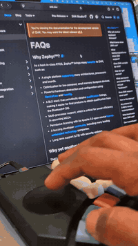

# RawTouch

[](https://github.com/kalakris/rawtouch/actions/workflows/ci.yml)
[](https://github.com/kalakris/rawtouch/releases/latest)
[](#what-you-need)
[](LICENSE)



Trackpad-style scrolling on macOS for the trackpads built into a ZMK
keyboard.

A keyboard trackpad normally scrolls by sending mouse-wheel events, which
carry no touch-down, lift-off or momentum phase. RawTouch reads the
finger's position from the keyboard and posts phased scroll gestures, the
kind a Mac trackpad produces. Apps then scroll smoothly,
coast after a flick, stop when you touch down again, and rubber-band at
the edges where they support it. Scrolling works vertically, horizontally
and diagonally.

RawTouch is a menu bar app. It needs keyboard firmware built with the
[`zmk-raw-touch`](https://github.com/kalakris/zmk-raw-touch) module, and it
does not change how an ordinary mouse or trackpad scrolls. Without the
app, the keyboard keeps pointing and wheel-scrolling by itself.

[Get started](#get-started) · [Adjust scroll feel](#adjust-scroll-feel) ·
[Troubleshooting](#troubleshooting) · [Configuration file](docs/configuration.md) ·
[How it works](docs/how-it-works.md)

## Get started

1. **Build and flash the firmware.** Go60 owners: the
   [Go60 configuration](https://github.com/kalakris/go60-rawtouch-config)
   has prebuilt firmware, and steps for building it with the keymap you
   made in MoErgo's Layout Editor. For other keyboards, follow the
   module's [setup guide](https://github.com/kalakris/zmk-raw-touch#setup).
   Both end with a check that ordinary wheel scrolling works before you
   install the app.
2. **Install the app.** Download the DMG from the
   [latest release](https://github.com/kalakris/rawtouch/releases/latest),
   move `RawTouch.app` into **Applications**, and open it. To check the
   download's origin first, see [Verify a download](#verify-a-download).
3. **Grant Accessibility.** On first launch a setup window opens. Click
   **Grant Access…** in it. macOS asks whether RawTouch may control the
   computer: choose **Open System Settings** there, then switch RawTouch
   on in **Privacy & Security → Accessibility**. RawTouch notices the
   grant by itself; no restart is needed: the setup window comes back to
   the front and says whether a keyboard is connected. If this does not
   go as described, see [Troubleshooting](#troubleshooting).
4. **Scroll.** Click the menu bar icon: your keyboard should be listed
   in **RawTouch mode**. Drag on the scrolling pad (the left pad in the
   Go60 configuration), activating the scroll layer if your keymap uses
   one. Flick and lift to coast; touch down again to stop.

Enable **Start at Login** in the menu to keep RawTouch running. There is
no Dock icon. To update, quit RawTouch, replace the app with the new
version, and reopen it; settings are kept.

## What you need

| Component | Requirement |
|---|---|
| Keyboard | ZMK firmware built with `zmk-raw-touch` 0.1 (protocol 4). The module needs a ZMK 0.3 / Zephyr 3.5 tree, such as MoErgo's; ZMK `main` is not supported yet |
| Trackpad | A trackpad supported by your keyboard firmware; tested with Cirque Pinnacle pads |
| Mac | macOS 13 or later; tested on Apple silicon running macOS 26 |
| Permission | Accessibility, so RawTouch can post scroll events |

The tested setup is a MoErgo Go60 with two Cirque pads, connected over USB
or Bluetooth. Intel Macs, earlier macOS versions, and other keyboards have
not been hardware-tested yet, nor have two RawTouch keyboards used at
once; test reports are very welcome.

Each pad tracks one finger, and one pad scrolls at a time. Cirque pads
report a single contact, so pinch-to-zoom and multi-finger gestures are
out of reach for now.

## Which repository?

| You have | Start here |
|---|---|
| A MoErgo Go60 | [go60-rawtouch-config](https://github.com/kalakris/go60-rawtouch-config): prebuilt firmware, or a configuration to fork |
| Another ZMK keyboard with a Cirque Pinnacle trackpad | [zmk-raw-touch](https://github.com/kalakris/zmk-raw-touch): the firmware module and its setup guide |
| Firmware with the module, and a Mac | [RawTouch](https://github.com/kalakris/rawtouch) (this repository): the macOS app |
| A question about the trackpad driver | [cirque-input-module](https://github.com/kalakris/cirque-input-module): the absolute-mode Pinnacle driver the module is tested with |

## How scrolling works

| Mode | What happens |
|---|---|
| **Standard mode** | The keyboard scrolls on its own with wheel events. No app needed. |
| **RawTouch mode** | The app scrolls from the finger's position, with gestures and momentum. |

Switching is automatic. While RawTouch runs with Accessibility permission,
the keyboard is in RawTouch mode; quit RawTouch or turn off **Use
RawTouch Scrolling** in its menu and the keyboard returns to Standard
mode. After a crash or force-quit, the return takes up to 30 seconds.
Pointer movement stays in the keyboard firmware and works the same in
both modes.

Drag to scroll and lift to coast. Touching any scrolling pad stops the
momentum. If your keymap uses a scroll layer, releasing the layer ends
the drag without momentum.

If your firmware enables taps on a scrolling pad, a quick tap clicks as
your keymap configures it; in the Go60 configuration, tapping the left pad
right-clicks. A touch that stops momentum does not click.

## Adjust scroll feel

Open **Settings** from the menu bar. Changes apply immediately. Start
with the defaults and change one thing at a time:

| Tab | What to adjust |
|---|---|
| **Scrolling** | **Scroll gain** sets distance at low speed; **Reverse scrolling** flips both directions. **Coasting time**, **Minimum flick speed** and **Maximum coast speed** shape momentum; **Flick sensitivity** decides how soon a fading touch counts as a flick. |
| **Advanced** | **Accelerate with finger speed** and its curve add reach to fast movements. **Sync scrolling to the display** smooths updates. |
| **Keyboards** | Settings for one keyboard, over USB and Bluetooth alike: rename it or its pads (click a heading), set a pad's own **Custom gain**, or choose its **Scroll axes** and directions under **Orientation**. |

RawTouch follows the macOS **Natural scrolling** setting; **Reverse
scrolling** flips the result.

The bottom of every tab shows the last gesture: finger speed on the pad,
gain, lift-off speed on screen, coasting distance, and whether flick
sensitivity carried the flick through the finger's fading contact
("carried N frames"). Use it while tuning: if flicks never read
"carried", flick sensitivity can go up; if ordinary lifts read "carried",
it should come down. A gesture over RawTouch's own windows updates the
readout without scrolling them, so you can flick while watching a slider.

**Restore Defaults…** resets the Scrolling or the Advanced tab; on the
Keyboards tab, **Remove Settings…** removes a keyboard's own settings.
Every setting is also a key in `~/.config/rawtouch/config.json`, which
RawTouch reloads when it changes; see
[Configuration](docs/configuration.md).

## Permissions and other mouse tools

RawTouch needs Accessibility to send scroll events to your applications.
That is a broad permission, which could also be used to observe
keystrokes. RawTouch does not: a
[test](Tests/RawTouchCoreTests/NoEventTapsTests.swift) fails CI if
any source file names an event-tap or keyboard-event API, and you can
check the installed binary yourself. This prints nothing, because the app
imports no event-tap symbol. RawTouch does post its scroll events at
the session event tap, the point where synthetic input enters the
session's event stream; posting there only adds events and cannot
observe any.

```sh
nm -u /Applications/RawTouch.app/Contents/MacOS/RawTouch | grep CGEventTap
```

RawTouch does not request Input Monitoring and writes only under your
home directory.

RawTouch checks for updates. About ten seconds after launch, then once a
day, and whenever you choose **Check for Updates…** in the menu, it
sends two anonymous requests to GitHub's API (`api.github.com`) for the
latest release of RawTouch and of `zmk-raw-touch`. The requests carry no
cookies or credentials and send only the app version, in the User-Agent.
RawTouch downloads and installs nothing; it lists newer releases in its
menu and marks its menu bar icon with a small up arrow. To turn the daily check off, clear **Check for updates
automatically** in **Settings → Advanced**; **Check for Updates…** still
works.

RawTouch works alongside pointer tools such as LinearMouse. Other mouse
utilities may also change scrolling. If direction or speed is
unexpected, compare with that utility temporarily disabled.

## Verify a download

Releases are notarized by Apple. To check that a download was also built
by this repository's release workflow, install the
[GitHub CLI](https://cli.github.com) and run this with the file you
downloaded, named `RawTouch-v<version>.dmg` or `.zip`:

```sh
gh attestation verify RawTouch-v<version>.dmg --owner kalakris
```

## Troubleshooting

| Symptom | Check |
|---|---|
| No keyboard appears in the menu | Confirm that the firmware includes `zmk-raw-touch` and speaks the protocol listed under [Firmware compatibility](#firmware-compatibility), then try USB. The [log](#reporting-a-problem) names each device it skips: "Device … has no supported raw touch feature report". Over Bluetooth, see the next rows. |
| Scrolling works over USB but not Bluetooth | After first installing the module, or an update whose release notes say so, forget the keyboard on the Mac, clear its bond on the keyboard (`&bt BT_CLR`; on a stock Go60 keymap, Magic + `=` on the selected profile), and pair again; see the [module troubleshooting](https://github.com/kalakris/zmk-raw-touch#troubleshooting). |
| The keyboard stays in Standard mode | Check **Use RawTouch Scrolling** in the menu and the Accessibility permission, then the keyboard's status in **Settings → Keyboards**. |
| Pointer works, but RawTouch scrolling does not | Activate the scroll layer if your keymap uses one, and check that **Use this pad** is on for it in **Settings → Keyboards**. For firmware setup, see the [module troubleshooting](https://github.com/kalakris/zmk-raw-touch#troubleshooting). |
| A pad does nothing, even with RawTouch quit | The cause is in the firmware or hardware, not the app; see the [module troubleshooting](https://github.com/kalakris/zmk-raw-touch#troubleshooting). Rarely, a pad does not respond after power-on: switch that half off and on. |
| One axis scrolls backward | Check that pad's direction overrides under **Orientation**, and the Natural scrolling and **Reverse scrolling** settings. Standard-mode direction is set in the firmware. |
| Horizontal movement scrolls vertically, or vice versa | Check the pad's **Vertical axis** setting under **Orientation**, and the firmware orientation. |
| No horizontal scrolling | Check the pad's **Scroll axes**, and try a view that scrolls sideways. In Standard mode, horizontal scrolling is configured in the firmware. |
| A straight drag drifts slightly sideways | Two-axis scrolling keeps the sensor's measured direction, including mounting skew. Set that pad's **Scroll axes** to Vertical to suppress it. |
| The app says "RawTouch is already running" and quits | Another copy is running; the alert gives its process ID (pid) when it can. Quit that copy from its menu bar icon, then reopen this one. To see where it lives, run `ps -o command= -p` followed by the process ID. |
| Scrolling stopped after a force-quit | Relaunch RawTouch, or wait up to 30 seconds for Standard mode to return. |
| The Accessibility request was dismissed, or the setup window is closed | Choose **Grant Accessibility…** in the menu to reopen the window. Its button now reads **Open System Settings** and opens the Accessibility list. If RawTouch is not in the list, click **+** below it and choose RawTouch in **Applications**. |
| Accessibility is enabled but not recognized | The entry belongs to another copy of the app, or to an earlier signature. Remove the RawTouch entry in **Privacy & Security → Accessibility** with **−**, then add the installed app again with **+** and switch it on. |

Apps may treat wheel events and scroll gestures differently. Apple Maps,
for example, zooms on the Standard-mode wheel but pans on RawTouch-mode
gestures.

### Reporting a problem

RawTouch writes diagnostics to the macOS unified log. Reproduce the
problem, then run this in Terminal to see the last five minutes (for a
connection problem, disconnect and reconnect the keyboard first):

```sh
/usr/bin/log show --last 5m --info --predicate 'subsystem == "io.github.kalakris.RawTouch"'
```

Use the full path: in zsh, the macOS default shell, a plain `log` runs a
shell builtin instead. The log covers device discovery, the lease,
measured latency, configuration errors and update checks. It contains
nothing you type and not the keyboard's hardware identifier, but read it
before posting it publicly.

In an issue report, include:

- the app version from **About RawTouch**, and the firmware version and
  protocol from **Settings → Keyboards → Firmware**
- your macOS version, keyboard and pad models, and the connection (USB or
  Bluetooth)
- whether the same action works in Standard mode
- for a scroll-feel problem, the **Last gesture** readout at the bottom of
  Settings right after the gesture
- the log output above
- if only one app is affected, its name and a short reproduction

## Firmware compatibility

| RawTouch app | Protocol | `zmk-raw-touch` module |
|---|---|---|
| 0.1.x | 4 | 0.1.x |

The app and firmware work together when they speak the same protocol
number. The two projects are versioned independently (`0.y.z`), so their
version numbers need not match. **Settings → Keyboards** shows the
module version and protocol a connected keyboard reports. On a split
keyboard, the other half's version appears after you first touch its pad.

## Uninstall

Turn off **Start at Login**, quit RawTouch, and move `RawTouch.app` to the
Trash. Remove `~/.config/rawtouch` as well if you do not want to keep your
settings, and remove the RawTouch entry in **System Settings → Privacy &
Security → Accessibility**. The firmware can stay: the keyboard scrolls in
Standard mode.

## Build from source

Building needs full Xcode (the app is universal). Then:

```sh
git clone https://github.com/kalakris/rawtouch.git
cd rawtouch
./scripts/make-app.sh
open ~/Applications/RawTouch.app
```

The script builds, signs and installs `~/Applications/RawTouch.app`. Grant
Accessibility to that copy as in [Get started](#get-started).
[CONTRIBUTING](CONTRIBUTING.md) covers signing, tests, and the code layout.

## Credits and license

[MIT](LICENSE). Parts of the scrolling implementation were developed in
and derived from [LinearMouse](https://github.com/linearmouse/linearmouse).
The license lists the derived files and is included in the app bundle.
The companion firmware is
[`zmk-raw-touch`](https://github.com/kalakris/zmk-raw-touch).
