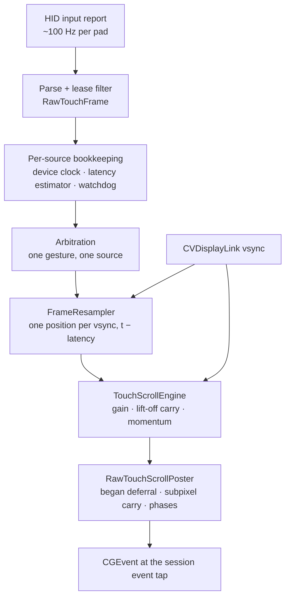

# How RawTouch works

For the curious and for contributors. None of this is needed to use the
app. The HID reports themselves are specified in the firmware module's
[wire format](https://github.com/kalakris/zmk-raw-touch/blob/main/docs/protocol.md).
Source paths below are under `Sources/RawTouchCore/`; every constant
named here is a `static let` there, with its reasoning beside it.

## In short

RawTouch does **no smoothing filter on finger position at all**. It
works out *when* each sample was taken, re-times the samples onto the
display's refresh by exact interpolation, applies one speed-dependent
gain, and spends most of its effort on the two hard moments of a
trackpad gesture: the finger landing and the finger leaving.

- **Timing.** Every sample's own device timestamp, not its arrival
  time, drives the velocity math, so Bluetooth batching does not distort
  it.
- **Display sync.** One position per display refresh, interpolated
  between real samples a few milliseconds back. That delay is measured
  per pad and connection, not configured.
- **Gain.** Physical 1:1 at slow speeds, rising smoothly to 16× for
  flicks, the same for both axes.
- **Lift-off.** Touch strength (`z`) shows when the finger is leaving,
  so the last unreliable positions do not decide the coast.
- **Momentum.** Exponential decay, caught by any touch.
- **Output.** Scroll events shaped like a real trackpad's, including the
  quirks WebKit and AppKit depend on.

| Stage | Technique | Numbers |
|---|---|---|
| Timing | device timestamps on the Mac's clock, pulled back to the earliest possible arrival | 100 µs ticks, 2 s re-anchor |
| Latency | per pad and connection: p90 of lateness within an epoch, held per gesture | +0.5 ms, 0–25 ms, 200 frames, 15 ms start |
| Display sync | exact interpolation at refresh − latency; capped extrapolation; overshoot kept, never given back | 10 ms cap |
| Velocity | recency-weighted least squares; quadratic for braking | 30 ms weighting, 100 ms window |
| Glitches | restart on impossible jumps | 512 counts |
| Gain | averaged speed → power-law gain, both axes | 40 ms, exponent 0.9, 40 mm/s, 1–16× |
| Lift-off | strength fade against the touch's p75; flick carried, landing followed | 0.6 floor, 100 ms history, 120 ms longest, −5/s braking |
| Momentum | exponential decay of the velocity vector | 0.55 s, start 23 mm/s, cap 4,600 mm/s, stop 40 points/s |
| Output | began held until its axis is known; remainders carried; real timestamps; session tap | 600 points/s, 30 / 80 ms |

The settings that tune these (scroll speed, acceleration curve, coast
decay, flick and coast speeds, lift strength floor) are described in
[configuration](configuration.md).

## Contents

1. [From finger to scroll event](#from-finger-to-scroll-event): the
   stages, and what a frame carries
2. [Modes and the host lease](#modes-and-the-host-lease)
3. [Recognizing a keyboard](#recognizing-a-keyboard)
4. [One gesture at a time](#one-gesture-at-a-time): pads, keyboards and
   connections
5. [When was a sample taken?](#when-was-a-sample-taken): the device clock
6. [Display sync](#display-sync): interpolation,
   [no backwards correction](#never-scroll-backwards-to-correct-a-guess),
   [the velocity fit](#the-velocity-fit),
   [measured latency](#how-much-latency)
7. [The engine](#the-engine): [gain](#a-physical-gain),
   [per frame](#each-touched-frame), [lift-off](#lift-off-what-z-is-for),
   [momentum](#momentum)
8. [Talking to apps](#talking-to-apps): the deferred began, remainders,
   timestamps
9. [Taps](#taps)
10. [Update check](#update-check)
11. [Benchmarks and validation](#benchmarks-and-validation)

## From finger to scroll event

Each stage, in order:

Drag and momentum use both coordinates. Acceleration uses their combined
speed and applies the same gain to both, so a diagonal stays diagonal.
RawTouch does not lock gestures to one axis, though applications may.
Selecting a single scroll axis leaves the other out of both the output
and the speed calculations.

### What arrives

Each touch frame (`RawTouchFrame.swift`, 11 bytes) carries:

| Field | Meaning |
|---|---|
| `pad_id`, `contact_id` | which pad; contact 0 only (the pads are single-touch, other contacts are dropped) |
| `x`, `y` | absolute position in the pad's raw counts (a Cirque Pinnacle in absolute mode, ≈ 38 counts/mm) |
| `z` | touch strength: grows with the contact patch. Not pressure, but it tracks how much finger is on the pad |
| `flags` | touched, scroll context, lease held, relayed / wireless relay |
| `seq` | per-pad 8-bit counter, diagnostic only |
| `ts` | device sample time, 16-bit, 100 µs ticks, wraps at 6.5536 s |

While touched, a pad streams one frame per sample (100 Hz, the
Pinnacle's ceiling). Lift-off sends exactly one release frame (`touched`
clear) and the stream goes silent. Contact state distinguishes a finger
held still from one that has lifted, which is what lets RawTouch coast on
lift-off and stop on touch-down.

Two things are discarded at once. A frame with **lease held** clear means
the keyboard is scrolling on its own (see [Modes and the host
lease](#modes-and-the-host-lease)), so synthesizing on top would
double-scroll; arriving mid-gesture, it is the trailing release of a
lapsed lease, and the gesture is canceled without momentum. And the x/y
of a release frame are never used: only its flags matter (see
[Lift-off](#lift-off-what-z-is-for)).

## Modes and the host lease

The keyboard scrolls on its own (Standard mode) unless a host holds a
**lease** on its touch stream. RawTouch acquires one per USB connection
or Bluetooth profile, asking for 30 seconds and renewing every 10. While
the lease is held, the firmware streams touch samples and suppresses its
own wheel events (RawTouch mode). RawTouch releases the lease when
disabled, on a normal quit, or when Accessibility permission is lost; it
checks the permission about once a second while ungranted and every five
seconds while granted. If RawTouch dies without releasing, the lease
expires within 30 seconds and the keyboard scrolls on its own again.

With a keyboard connected over both USB and Bluetooth, a switch of
connection mid-scroll hands the gesture over. The keyboard's frames for
the same pad arriving over the other connection take the gesture over at
once, recognized by the hardware identifier every connection of a
keyboard reports, and scrolling continues from where the finger is: no
new gesture, no jump, no momentum. The gesture adopts the new
connection's measured latency (see [Display sync](#display-sync)). Frames still in flight on the old
connection are ignored. If the new connection's frames come more than
150 ms after the old one's last, or macOS reports the old connection gone
before they arrive, as can happen when USB is unplugged, the gesture
ends without momentum and a new one starts on the other connection.
Disconnecting an unrelated keyboard does not end the active gesture.

## Recognizing a keyboard

Discovery looks for the vendor HID collection, then reads the feature
report and checks its `RAWT` magic, protocol version and length before a
device is treated as a keyboard or written to. That is identification,
not authentication.

The same report carries the keyboard's hardware identifier, read from its
chip and identical over USB and Bluetooth. That is how RawTouch shows one
keyboard rather than one entry per connection, and what per-keyboard
settings are keyed by. It also carries the module version of each half;
a split keyboard's other half announces its version with its first
touch, and RawTouch then re-reads the report. The pad's resolution in
counts per millimetre and its mounting (rotation, inversion) come from
this report too.

## One gesture at a time

macOS gets one scroll stream, so `TouchScrollPipeline` runs one engine
and one gesture at a time, across every pad of every connected keyboard.
Each *source* (a pad on one connection) keeps its own device clock,
latency estimate and watchdog.

- **First touch wins.** Every other source's frames, releases included,
  are dropped until the gesture is over.
- **Cross-pad catch.** While the owner is only coasting (finger up,
  momentum running), a scroll touch on any source stops the coast and
  takes the gesture. Otherwise a coast's last, invisible second would
  lock the other pad out.
- **Handover** to the keyboard's other connection, as described above:
  same pad, same hardware identifier, a device timestamp newer than the
  owner's last.
- **Stale-touch watchdog.** 150 ms of silence while touched ends the
  touch without momentum. The firmware retries its release frame until it
  is sent, so this covers the stream simply stopping: an unplug, a lost
  link.

At each touch-down the pipeline also resolves the density of the display
under the cursor and starts that display's vsync, and keeps both for the
gesture.

## When was a sample taken?

Over Bluetooth, frames sampled 10 ms apart arrive in bursts at the
connection interval: gaps between arrivals alternate between ~0 and
15 ms or more, and any velocity computed from arrival times would be
wrong. So `RawTouchDeviceClock` replaces each frame's timestamp with its
**device sample time** on the Mac's clock:

1. The first frame anchors the timeline at its arrival time.
2. Each later frame advances it by the exact (wrapping) 16-bit tick
   delta.
3. A sample cannot be taken after it arrives. If the reconstructed time
   is later than the arrival, the anchor frame must have been delivered
   slowly, so the timeline snaps back to this arrival. It moves back only
   at each new minimum, never forward, and stays monotonic. Without this,
   a gesture whose first frame waited a whole connection interval would
   carry that delay into every later timestamp, and resampling, which
   estimates positions at host times, would turn it into scroll latency.
4. A gap above 2 s, in device time or in arrival time, re-anchors: far
   longer than any real gap within a touch, far shorter than the 6.5 s
   wrap.

On a split keyboard the firmware stamps the other half's pad with *that
half's* sample time, so the relay hop becomes lateness the host can
measure (next section) instead of jitter it cannot see.

## Display sync

A Pinnacle pad reports at most 100 samples per second, so on a 120 Hz
display every sixth frame would have no new sample: a visible ~20 Hz
judder. Bluetooth batching makes it worse.

With **Sync scrolling to the display** on (the default),
`FrameResampler` emits **exactly one position per refresh** of the
display under the cursor, for the instant *t − latency*, where *t* is
the refresh:

1. **Bracketed:** two real samples straddle that instant → exact linear
   interpolation between them. No filter, no lag beyond the latency.
2. **Ahead of the data:** the newest sample is older → extrapolate from
   it with the velocity fit below, but never more than **one sample
   period (10 ms)** past it. Beyond that the position holds, so a finger
   that stopped or lifted is not run on. A refresh that hits this cap is
   counted as a *held* frame, the stutter count the readout shows.
3. The first refresh of a touch emits the touch-down sample itself, so
   the gesture starts from the real landing position and its first
   milliseconds of motion are kept.

Momentum rides the same refreshes. If no display link can be made, or the
running one goes silent for 100 ms, frames go to the engine as they
arrive and momentum runs on a 120 Hz timer.

### Never scroll backwards to correct a guess

Extrapolation overshoots when the finger stops, and the next estimate
gives the overshoot back. Showing that as content stepping backwards
would be worse than the overshoot, so emission is relative, per axis:

- Each refresh moves the output by the **estimate's change**.
- A step back **against the last extrapolation**, up to that
  extrapolation's size, is the guess being returned, not finger motion:
  nothing is emitted and the difference is kept.
- A step back **larger** than the last extrapolation is a real reversal
  and passes through at its own size.

The overshoot becomes an offset of at most one extrapolation per hard
stop, invisible because scrolling is relative and the gain already breaks
any fixed finger-to-content mapping. There is no dead zone: motion
resuming in the same direction scrolls on the very next refresh.

A jump of more than 512 counts between samples is a sensor glitch (no
finger moves that far in 10 ms). Tracking restarts there, so the jump
reaches the engine whole and is discarded instead of being spread across
several plausible-looking refreshes.

### The velocity fit

`WeightedVelocityFit`, used for extrapolation here and for the momentum
seed at lift-off, is a **recency-weighted least-squares line** through
the last 100 ms of samples, each weighted `exp(−age / 30 ms)` relative to
the newest. Its slope is the velocity.

- It is exact for constant velocity whatever the weights, so a steady
  drag is never biased.
- About three frames carry most of the weight, so it reads the speed
  *now*: a flick still accelerating at release seeds at its final speed,
  not its average. Fitting every sample still resists the single-frame
  noise a two-point difference would pass through.
- A stop-then-lift fits a flat line, so the velocity comes out near zero
  and nothing coasts.

A weighted **quadratic** variant gives velocity and acceleration at the
newest sample; lift-off uses it to tell braking from flicking.

### How much latency

Too little latency and the needed sample has not arrived when the
refresh comes, so the frame holds; too much and scrolling lags. What a
pad needs depends on the whole path its frames take. On the tested
keyboard:

| Path | p90 lateness | Knee of the sweep |
|---|---|---|
| USB, the central half's own pad | 0.9 ms | 0 ms |
| USB, pad relayed over a wired split link | 4.9 ms | 3 ms |
| USB, pad relayed over a wireless split | 10.0 ms | 10 ms |
| Bluetooth to the Mac, either pad | 13.7–15.6 ms | 13–15 ms |

Whether the halves are wired can change mid-session, so the latency is
measured, not set. `RawTouchLatencyEstimator`, per pad on each
connection:

- takes each frame's **offset**, arrival minus device time;
- groups frames into **epochs**, runs on one continuous device timeline
  (broken by the same 2 s rule, and every 10 s, so drift between the
  halves' crystals never reads as lateness);
- takes a frame's **lateness** as its offset above the smallest offset
  in its epoch: the fastest delivery that path has managed;
- keeps the last **200 frames**, a count of frames rather than a span of
  time, so idle periods forget nothing, and leaves out epochs under 10
  frames: a tap has not seen the path's fastest frame, so all of its
  frames would look on time;
- estimates **p90 of lateness + 0.5 ms, clamped to 0–25 ms**.

The percentile comes from replaying recorded deliveries through the
offline benchmark at every latency: on every path, the point where more
latency stops buying smoothness sits at or just under p90 (see
[`bench/captures/`](../bench/captures/README.md)). A pad's first
gesture on a new connection runs at a **15 ms** starting value, slightly
laggy rather than stuttery. Once 20 frames from touches longer than a tap
have been measured, the measurement takes over at the next touch-down.

The latency is adopted at touch-down and **held for the whole gesture**.
Changing it mid-gesture would ask for an earlier instant than has
already been shown, moving content under a moving finger. A handover to
the keyboard's other connection is the one exception, and adopts that
connection's value.

The Advanced tab's **Latency** row shows what each pad has measured on
each connection. The last-gesture readout shows the latency the gesture
ran at, its connection, and how many display frames had to wait for a
late sample.

## The engine

`TouchScrollEngine` is a state machine (idle → touching → coasting) fed
one frame per refresh, plus a momentum step per refresh while coasting.
Every rule works on the two-dimensional vector.

### A physical gain

**Scroll speed** (`scale`) is a gain relative to physical 1:1: at 1.0, a
millimetre of finger travel scrolls a millimetre of screen.

    points per count = scale × (display points per mm) ÷ (pad counts per mm)
                     ≈ 1.0 × 4.3 ÷ 38 ≈ 0.11

The pad's resolution comes from its keyboard (38 if it reports none),
the display's density from macOS for the display under the cursor (4.3
if it reports none). The other speeds in the configuration are physical
too: finger speeds in mm/s on the pad, coast speeds in mm/s on screen.

### Each touched frame

    delta    = position − previous position        (a disabled axis is zeroed)
    if |delta| > 512 counts on either axis: re-anchor, emit nothing
    speed    = |delta| / dt                          (both axes together)
    smoothed = exponential average of speed, τ = 40 ms,
               starting from the first frame's speed
    gain     = clamp((smoothed / 40 mm/s) ^ 0.9, 1, 16)
    output   = delta × gain × points per count × direction signs

- **One gain for both axes**, from the combined speed.
- The average is the **only smoothing in the pipeline**, and it smooths
  the gain, not the position: about four frames, enough to keep the gain
  steady, quick enough to boost a flick from its first frames. Starting
  from the first frame's speed rather than from zero puts neither a slow
  drag nor a fast flick in the wrong regime.
- With the defaults the gain is 1 below 40 mm/s, for precision, and
  reaches 16× around 870 mm/s, the reach a pad a fraction of the screen's
  size needs.
- The direction signs combine the pad's mounting, the per-pad direction
  settings and the live macOS **Natural scrolling** setting. macOS
  applies that setting to the keyboard's own wheel events but not to
  synthetic ones, so following it keeps both modes scrolling the same
  way.

### Lift-off: what z is for

As a finger lifts, the contact patch shrinks over the last 2–9 frames,
and the reported position **moves with the shrinking patch**. Those last
frames' motion is not the finger's, and a velocity fitted through them
can come out far too slow or in the wrong direction.

**Detecting the fade.** Every strength reported since touch-down goes
into a histogram, whose **75th percentile** is the touch's reference (a
percentile, so one hard press does not set it). A frame is *weak* below
**0.6 × the reference**, judged only once the touch has 100 ms of history
(a touch-down also starts weak and must not look like a lift). The 0.6
comes from recorded touches (`bench/lift-strength.py`): the body of a
touch stays at or above 0.63 of its reference in 95 % of frames, motion
is trustworthy down to about 0.5–0.6, and the momentum it produces barely
changes for floors between 0.5 and 0.7.

**One decision, at the first weak frame**, from firm-contact frames
only:

- A **flick**: at least three samples, fast enough to coast, and not
  braking hard (acceleration along the direction of travel, divided by
  speed, from the quadratic fit, no lower than −5 per second; −5/s would
  halve the speed in about 140 ms, and 32 of 37 recorded flicks sat above
  it while most landings sat well below). The fading frames then each
  emit the firm-contact velocity at the gain in force when the fade
  began, whatever position they report, and the coast starts from that
  same velocity, so the hand-off to momentum is seamless.
- Anything else, such as slowing onto a target: the fade is real slowing,
  and the finger is followed as reported.

A carry lasts at most 120 ms. A longer fade is a light touch, not a
lift, and the finger is followed again from where it is, without a jump;
firm contact returning does the same.

**The momentum seed** is the carried velocity, or else the fitted finger
velocity × the gain in force at lift × points per count. The gain is
applied once, to the fitted velocity, rather than fitted through
gain-scaled positions: the gain trails the finger by its 40 ms average,
and a fit through scaled positions takes that lag in. On recorded flicks
that gives a median 0.69 of the peak speed × peak gain, against 0.96 this
way.

### Momentum

    coast if the seed ≥ 23 mm/s on screen; cap it at 4,600 mm/s, keeping its direction
    each refresh:  velocity ← velocity × exp(−dt / 0.55 s); move by velocity × dt
    stop below 40 points/s

- The speed decays and the direction holds. A coast travels about
  `seed × 0.55 s` and lasts `0.55 s × ln(seed / 40)`: a 2,000 points/s
  flick runs about 1,080 points over about 2.2 s.
- `dt` is clamped to 1/240–1/24 s, so a late or doubled refresh never
  makes a jump.
- 40 points/s is a third of a point per 120 Hz frame, invisible, yet
  every frame below it would still post a momentum event and keep apps
  in their momentum state. Safari keeps a rubber-band bounce open for as
  long as that stream lasts.
- A touch-down while coasting stops the coast at once, on the same pad
  or another.
- Leaving the scroll layer mid-touch, a lapsed lease, a silent stream or
  a change to the pad's axes all end the gesture without momentum: motion
  the user did not ask for.

## Talking to apps

`RawTouchScrollPoster` turns the engine's output into pixel-unit,
continuous, phased scroll events: a scroll phase (began, changed, ended,
cancelled) while touching and a momentum phase (begin, continue, end)
while coasting, plus the gesture events a real trackpad sends around them
(may-begin and a series start at touch-down, a gesture event per phased
scroll, a series end after ended or cancelled).

Scroll events are posted at the session event tap, never the HID tap, so
RawTouch composes with other mouse tools. Utilities that modify those
synthetic events can still change the result.

### The began waits for a direction

Two facts about the apps receiving the events:

1. WebKit reads the **whole-point** delta. A began worth less than one
   point counts as zero and never reaches its rubber-band handling; a
   scroll that lands during a bounce then vanishes, momentum included.
2. WebKit and Chromium **lock a gesture to the main axis of its first
   event**. A landing finger flattens onto the pad and the contact centre
   slides sideways 1–5 points over the first frames; a began led by that
   slide locks a vertical flick horizontal, and all of its vertical
   motion is ignored.

So motion accumulates without being posted until one of these rules
decides, first match winning:

| Axis | Evidence | From | At least | Other axis under |
|---|---|---|---|---|
| vertical | one frame's speed | 0 ms | 600 points/s | ⅓ |
| horizontal | one frame's speed | 0 ms | 600 points/s | ⅓ |
| vertical | motion so far | 30 ms | 2 points | ⅓ |
| vertical | motion so far | 30 ms | 4 points | ½ |
| horizontal | motion so far | 30 ms | 8 points | ⅓ |
| horizontal | motion so far | 30 ms | 12 points | ½ |
| horizontal | motion so far | 80 ms | 8 points | ½ |
| vertical | motion so far | 80 ms | 1 point | any |

The winning axis must hold a whole point. The began carries that axis
alone; the other axis's motion rides on the next event, so nothing is
lost. A flick (600 points/s is 6 points per frame, more than any recorded
landing slide) decides at once. Vertical, the common case and never the
slide's direction, needs little evidence; horizontal has to travel
further than a slide does. A lift releases a began still waiting, on the
main axis; a touch that never reaches a whole point ends as cancelled,
with no coast, as on a real trackpad.

### Other details

- **Whole points carry their remainders.** The whole-point delta (what
  AppKit's `scrollingDeltaY` reads) is truncated with the remainder kept
  per axis, through the coast too; dropped instead, a coast would lose up
  to a point per frame and stop early in AppKit apps. The exact
  fractional delta goes in its own field.
- **Real timestamps.** Each event is stamped with the current time.
  Synthetic events otherwise carry none, and Safari's high-refresh
  momentum handling fits its velocity curve to event timestamps.
- A gesture that begins over RawTouch's own window posts nothing; the
  settings window's readout still sees it.
- Events carry a marker identifying them as RawTouch's.

## Taps

The firmware decides what a tap is and what it does. A pad set to hold
back scroll taps waits at lift-off, because only the host knows whether
that tap was a finger stopping a coast. RawTouch confirms the tap when
the touch was in scroll context throughout, did not stop a coast, ended
in a leased release frame, and was tap-sized: at most 300 ms and 60
counts of travel, a loose filter, since the firmware's own thresholds
decide.

## Update check

RawTouch says when a newer app or firmware release is out; it never
downloads or installs anything. About ten seconds after launch and then
once a day while **Check for updates automatically**
(`updates.checkAutomatically`) is on, and whenever you choose **Check for
Updates…** in the menu, it asks GitHub's API for the latest release of
RawTouch and of `zmk-raw-touch`: one anonymous HTTPS request to
`api.github.com` each, with no cookies, cache or credentials, naming only
the app version in its User-Agent. Of the answer it reads the release's
tag and page.

The menu then lists a release newer than the running app, and a module
release newer than a connected keyboard's firmware; choosing one opens
the release page. While it lists one, the menu bar icon carries a small
up-arrow mark, left off only while the icon shows the attention triangle.
A development build (`0.0.0-dev`) is never offered the
app. A keyboard reports its module version as major.minor only, so a
patch release (0.2.1 for a keyboard on 0.2) is not offered. A half that
has not reported its version yet, such as a split's other half before
its first touch, is left out; a keyboard is out of date when any half it
has heard from is older. An automatic check only updates the menu, and
one that fails is only logged. A check from the menu is answered with an
alert, since choosing the item closes the menu: the updates found, with a
button to their release pages, or that there are none, or that GitHub
could not be reached.

## Benchmarks and validation

`swift run scroll-bench --offline` is the deterministic cadence check:
scripted finger motion at a 120 Hz display rate through the real
pipeline, no hardware, no posted events. `--replay bench/captures/*.csv`
drives it with recorded deliveries and `--sweep` sweeps the latency.
`bench/lift-strength.py <capture.csv>` checks the lift strength floor on
any pad. For live browser experiments, see
[`bench/safari-bounce/`](../bench/safari-bounce/README.md). A browser's
page-side animation log may run at a different rate from the display, so
it cannot by itself verify display-rate delivery.

The settings window's **Last gesture** readout shows peak finger speed
(mm/s on the pad), peak gain, lift-off speed and frames carried, coast
distance, and the latency the gesture ran at with its held-frame count.
